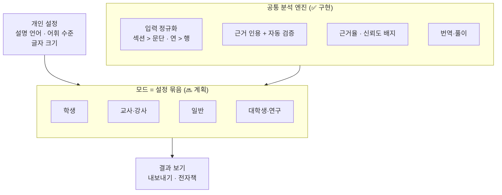
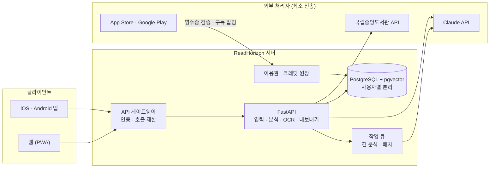

# ReadHorizon 제품 요구사항 문서 (PRD)

| 항목 | 내용 |
|---|---|
| 문서 버전 | v0.1 (초안) |
| 작성일 | 2026-09-26 |
| 용도 | 외부 제출·설득용 (지원사업·투자·협력 검토) |
| 기준 코드 | 브랜치 `claude/literary-analysis-program-design-0pfrrk`, 커밋 `6187f08` (웹 MVP + 이미지 텍스트 추출) |
| 형식 | 원본 `docs/PRD.md` · Word 판 `docs/PRD.docx` (원본에서 생성) |
| 관련 문서 | [설계 결정 기록](design.md) · [README](../README.md) |

**상태 표기**

| 표기 | 뜻 |
|---|---|
| ✅ 구현 | 현재 코드에 있고 자동 테스트로 확인됨 |
| 🔜 계획 | 이 문서에서 요구하는 기능. 아직 없음 |
| 🧪 가설 | 수치·가격·목표값. 실측이나 시장 검증으로 확정해야 함 |
| ❓ 결정 필요 | 운영 주체가 정해야 하는 사항 (16장에 모음) |

---

## 0. English Summary

**ReadHorizon** is an evidence-grounded reading companion. Users bring any text (novels, poems, plays, essays, Korean classics, textbooks, exam passages, research papers) as a file, pasted text, or photo. ReadHorizon explains context, paragraph flow, meaning, vocabulary, and translation, and ties every claim to a quoted location in the original text. A second pass checks that each quote really exists there.

- **Problem.** Reading literacy is declining. Korean adults who read at least one book a year fell to 38.5% in 2025, the lowest since 1994. The OECD average PISA reading score dropped 10 points between 2018 and 2022. Meanwhile about 490,000 Korean students sat the national exam's Korean-language section, and 488,000 its English section, in 2026. Generic AI chatbots give fluent answers that cannot be traced back to the text.
- **Solution.** One grounded analysis engine with four modes:
  - K-12 / exam students
  - Teachers and tutors
  - General readers
  - University students and researchers

  Modes share features, so users move between them as their needs change.
- **Languages.** Korean and English: UI, source texts, explanations, and Korean-English translation.
- **Formats.**
  - Input: PDF, TXT, MD, DOCX, HWPX, images (built); EPUB (planned).
  - Export: MD, TXT, PDF, DOCX, image cards, and study e-books in EPUB (planned).
- **Status.** A working web MVP with 147 automated tests, CI, and Docker deployment. It covers file and OCR input, citation verification, a grounding ratio, trust badges, PII masking, and retention limits. Next step: mobile apps (iOS/Android).
- **Business model.** B2C, individual users, priced in USD. The recommendation is freemium plus a credit-based subscription (Plus $9.99 / Pro $19.99 per month, hypothesis). Estimated contribution margin is 40–44% at typical usage with a 15% store fee (hypothesis, section 12).

---

## 1. 요약

**한 줄 정의**: 읽고 싶은 글을 넣으면, 원문의 어느 부분이 근거인지 짚어 가며 문맥·흐름·의미·어휘·번역을 풀어 주는 **근거 기반 독해 도우미**입니다.

| 구분 | 내용 |
|---|---|
| 문제 | ① 독서율과 독해력이 떨어지고 있습니다(성인 독서율 38.5%, 조사 이래 최저). ② 수험생·교사·일반 독자·연구자가 필요한 도움이 서로 다른데, 도구는 한 가지 방식만 제공합니다. ③ 범용 AI 답변은 원문 어디에 근거했는지 확인하기 어렵습니다. |
| 해결 | ① 모든 분석에 원문 위치 인용을 붙이고 자동으로 대조합니다. ② 하나의 분석 엔진 위에 **4가지 사용자 모드**를 두고, 모드끼리 기능을 공유합니다. ③ 한국어·영어, 여러 입력·출력 형식(전자책 포함)을 지원합니다. |
| 현재 | 웹 MVP 동작. 파일·붙여넣기·사진(OCR) 입력, 근거 인용과 자동 검증, 근거율·신뢰도 배지, 개인정보 자동 가림, 배포 구성(Docker·CI), 자동 테스트 147개 |
| 다음 | 모바일 앱(iOS·Android), 계정과 개인 결제(USD), 모드별 기능 확장, 내보내기·전자책 |
| 운영 | 개인 대상(B2C), USD 결제. 무료 + 크레딧형 구독을 권장합니다(12장) |

---

## 2. 문제와 기회

### 2-1. 데이터로 본 현황

| 지표 | 수치 | 시사점 | 출처 |
|---|---|---|---|
| 2026학년도 수능 응시자 | 493,896명 (국어 영역 490,989명, 영어 영역 487,941명) | 매년 약 49만 명이 한국어·영어 독해 평가를 치릅니다. 학생 모드의 핵심 사용자층입니다 | 교육부·평가원 채점 결과 |
| 2026학년도 수능 지원자 | 554,174명 (전년 대비 31,504명 증가) | 지원자가 늘었습니다 | 평가원 응시원서 접수 결과 |
| 2025년 초중고 사교육비 | 총 27.5조 원, 참여율 75.7%, 참여 학생 1인당 월 60.4만 원 | 학습 지원에 대한 지출 의향이 높습니다. 저가 보조 도구가 들어설 여지가 있습니다 | 교육부·국가데이터처 |
| 2025년 성인 연간 종합독서율 | 38.5% (1994년 조사 이래 최저), 연간 2.4권 | 일반 독자의 "읽기 어려움"을 줄여 주는 도구가 필요합니다 | 문화체육관광부 국민 독서실태 조사 |
| 2025년 학생 연간 종합독서율 | 94.6% (연 31.5권, 4.5권 감소) | 학생은 많이 읽지만 읽는 양이 줄고 있습니다 | 같은 조사 |
| 19~29세 종합독서율 | 75.3% (0.8%p 상승) | 대학생·청년층은 읽기 수요가 유지되고 있습니다 | 같은 조사 |
| PISA 2022 읽기 OECD 평균 | 476점 (2018년 대비 10점 하락, 역대 최대 폭) | 읽기 능력 저하는 한국만의 문제가 아닙니다. 영어권 확장의 근거가 됩니다 | OECD PISA 2022 |

### 2-2. 사용자별 문제

| 사용자 | 지금 겪는 문제 |
|---|---|
| 초중고·수험생 | 지문의 문단 관계와 흐름을 스스로 잡기 어렵습니다. 고전 문학의 옛말·한자어가 막힙니다. 해설서는 정해진 지문만 다루고, 왜 그 선지가 맞는지 원문 근거를 짚어 주지 않습니다 |
| 교사·강사 | 수업 자료를 학생 수준에 맞추려면 어휘·문장·흐름을 손으로 고쳐야 합니다. 어떤 부분이 어려운지 객관적으로 보여 줄 도구가 없습니다 |
| 일반 독자 | 잘 모르는 분야의 책은 각 부분이 무엇을 논하는지 놓치기 쉽습니다. 모르는 개념에서 멈추면 독서를 포기합니다 |
| 대학생·연구자 | 외국어 논문을 번역기로 읽으면 헤지 표현("may", "suggest")의 강도, 한정어, 전문용어의 뜻이 사라집니다. 긴 논문에서 서론·방법·결과·논의 구조를 빠르게 파악하기 어렵습니다 |

### 2-3. 기존 대안의 한계

| 대안 | 한계 | ReadHorizon의 차이 |
|---|---|---|
| 범용 AI 챗봇 | 답이 유창하지만 원문 어디에 근거했는지 확인하기 어렵고, 없는 내용을 지어내도 알기 어렵습니다 | 문단(시는 행) 단위 인용을 붙이고, 인용문이 원문에 실제로 있는지 자동으로 대조합니다 |
| 인강·해설서 | 정해진 지문만 다룹니다. 비용이 크고, 내 자료에는 쓸 수 없습니다 | 사용자가 가져온 어떤 글이든 분석합니다 |
| 번역기·사전 | 문장이나 단어 단위라 문맥과 글 전체 흐름을 설명하지 못합니다 | 문단 흐름, 글 구조, 번역 손실 경고를 함께 제공합니다 |
| 논문 요약 도구 | 영어 중심입니다. 한국어·고전 문학·수험 독해를 다루지 않습니다 | 한국어·옛한글·한자 원형을 유지하고, 수능형 독해와 논문 읽기를 한 엔진에서 지원합니다 |

### 2-4. 왜 지금인가

- **근거 인용 기술의 성숙**: Claude API의 Citations 기능으로 원문 위치(문단 번호)를 돌려받을 수 있습니다. ReadHorizon은 이 위치를 다시 원문과 대조해 검증까지 합니다(✅ 구현).
- **사진 한 장으로 입력**: 비전 모델로 교재·시험지 사진에서 글자를 추출할 수 있습니다. 옛한글·한자·세로쓰기도 한 모델로 처리합니다(✅ 구현, 옛한글 정확도는 실측 예정).
- **원가 하락**: 중간 등급 모델(Sonnet 5)의 표준 가격이 입력 $2 / 출력 $10(100만 토큰당)으로 확정됐습니다. 작업별 모델 배분으로 현재 기본 설정 대비 표준 작업 원가를 약 60% 줄일 수 있습니다(12-4, 🧪).
- **신뢰 요구 증가**: 인공지능 기본법(2026-01-22 시행)이 생성형 AI 결과물 표시와 사전 고지를 요구합니다. "근거를 보여 주는 AI"가 규제 흐름과 맞습니다.

---

## 3. 비전과 원칙

**비전**: 누구나 어려운 글을 끝까지, 정확하게 읽을 수 있게 돕는다. 정답을 대신 읽어 주는 것이 아니라 **스스로 읽는 힘**을 키운다.

**용도**: 독해·어휘·사고력 등 교육과 능력 발전, 연구와 학습을 돕습니다.

### 3-1. 제품 원칙

| 원칙 | 의미 | 상태 |
|---|---|---|
| 근거 우선 | 모든 사실 진술에 원문 인용을 붙입니다. 근거가 없으면 "원문에서 근거를 찾을 수 없습니다"라고 답합니다 | ✅ |
| 사실과 해석 구분 | 줄거리·화자·표현법은 사실, 주제·상징은 해석으로 표시합니다. 해석이 갈리면 여러 관점을 나란히 제시합니다 | ✅ |
| 스스로 읽기 우선 | 학생 모드는 해설을 바로 주지 않고 "먼저 요약해 보기 → 힌트 → 해설" 순서로 단계적으로 엽니다 | 🔜 |
| 사용자에 맞춤 | 같은 글도 모드·수준·설명 언어에 따라 다르게 풀어 줍니다. 모드는 언제든 바꿀 수 있습니다 | 🔜 |
| 개인정보 최소 수집 | 계정 없이도 쓸 수 있습니다. 민감정보는 저장·전송 전에 자동으로 가립니다. 수집 항목은 화면에 고지합니다 | ✅ (계정은 🔜) |
| 저작권 존중 | 서점 페이지를 크롤링하지 않습니다. 사용자 자료는 그 사용자만 쓰고, 공용 DB나 AI 학습에 쓰지 않습니다 | ✅ |

### 3-2. 목표와 비목표

| 목표 | 비목표 |
|---|---|
| 4가지 사용자 모드에 맞춘 근거 기반 독해 지원 | 숙제·시험 대리 풀이 서비스 (단계적 힌트로 설계) |
| iOS·Android 앱과 웹을 같은 계정·자료실로 연결 | 전자책 판매·유통 (사용자 소장용 학습 전자책 생성만) |
| 한국어·영어 UI와 콘텐츠 | 영어 외 다국어 (영어 안정화 후 검토) |
| 개인 대상 USD 결제 | 학교·기관 일괄 계약 (B2B는 개인 모델 검증 후 검토) |
| 여러 입력·출력 형식 | DRM이 걸린 전자책 가져오기 (기술적 보호조치 해제 금지) |

---

## 4. 사용자와 모드

### 4-1. 4가지 사용자 모드

| 모드 | 대상 | 핵심 과업 | 대표 기능 | 기본 설정 |
|---|---|---|---|---|
| **학생** | 초·중·고 학생, 수험생 (만 14세 미만 포함) | 지문 분석, 문맥·문단 관계, 이어지는 흐름, 읽는 방법, 고전 문학, 어휘 | 지문 구조 분석, 단계적 힌트, 선지 근거 판단, 고전 현대어 풀이, 어휘장·복습, 영어 지문 독해 | 쉬운 설명, 해설 단계 공개, 어휘 주석 켜짐 |
| **교사·강사** | 학교 교사, 학원·과외 강사 | 자료 분석, 가시성·어휘·문맥 흐름 수정·개선 | 가독성 진단, 개선안 비교·승인, 어휘 목록, 흐름도, 발문 초안, 학습지 내보내기 | 진단 지표 표시, 편집 도구 켜짐 |
| **일반** | 성인 독자 | 모르는 분야·어려운 책에서 각 부분이 무엇을 논하는지 이해 | 장·절별 요지, 배경지식·용어 풀이, 질문하기, 독서 노트 | 요약 중심, 배경 설명 켜짐 |
| **대학생·연구** | 대학(원)생, 연구자 | 논문·연구자료를 읽을 때 번역에서 빠지는 의미 보완, 서론·본론·결론 구조 파악 | 구조 분할(IMRaD), 원문·번역 병렬 보기, 번역 손실 경고, 용어집, 주장·근거 맵 | 병렬 보기, 원어 용어 유지 |

### 4-2. 페르소나 (설계용 가상 인물)

| 모드 | 페르소나 | 상황 | ReadHorizon으로 하는 일 |
|---|---|---|---|
| 학생 | 고3 수험생 | 독서(비문학) 지문에서 문단 관계를 놓쳐 시간 부족 | 기출 지문 사진을 찍어 넣고, 먼저 문단 요지를 스스로 적은 뒤 힌트와 비교합니다. 틀린 선지는 원문 근거 문단을 확인합니다 |
| 학생 | 초등 5학년 (만 14세 미만) | 교과서 수필의 어려운 낱말 | 보호자 동의 후 쉬운 말 풀이와 낱말 카드를 씁니다. 결제·외부 링크는 막혀 있습니다 |
| 교사 | 중학교 국어 교사 | 학급 수준에 맞는 읽기 자료 준비 | 자료의 가독성을 진단하고, 어려운 문장의 개선안을 비교해 승인한 뒤 학습지(DOCX)로 내보냅니다 |
| 일반 | 30대 직장인 | 경제학 교양서가 3장에서 막힘 | 3장의 절별 요지와 핵심 개념 풀이를 보고, 궁금한 점을 질문해 원문 근거와 함께 답을 받습니다 |
| 연구 | 대학원생 | 영어 논문 20편 문헌 조사 | 논문을 구조별로 나눠 보고, 번역에서 약해진 헤지 표현 경고를 확인하고, 용어집을 모아 내보냅니다 |

### 4-3. 유기적 모드 설계

사용자 요구에 맞게 기능이 유기적으로 연결되도록, 모드를 **별도 제품이 아니라 공통 엔진 위의 설정 묶음**으로 설계합니다.

- **모드 전환**: 같은 작품을 다른 모드로 다시 볼 수 있습니다. 예를 들어 교사가 학생 모드로 미리 보고, 연구 모드 사용자가 일반 모드의 쉬운 요약을 볼 수 있습니다. 분석 결과는 작품에 쌓여 모드를 바꿔도 사라지지 않습니다.
- **모드 추천**: 입력 문서의 종류를 감지해 모드를 제안합니다. 예를 들어 초록·참고문헌이 있으면 연구 모드를 제안합니다. 결정은 사용자가 합니다.
- **개인 설정**: 설명 언어(한국어·영어), 어휘 수준(학년 또는 영어 CEFR 단계), 글자 크기, 출력 형식을 모드와 따로 저장합니다.
- **기능 공유**: 아래 표처럼 기능은 한 모드에 묶이지 않습니다. 모드는 기본 노출과 기본값만 정합니다.

| 기능 | 학생 | 교사 | 일반 | 연구 |
|---|:---:|:---:|:---:|:---:|
| 근거 인용 분석·질의응답 ✅ | ● | ● | ● | ● |
| 문단 흐름 분석 ✅ | ● | ● | ○ | ○ |
| 번역·풀이 (현대어·쉬운 말·영어·한국어) ✅ | ● | ○ | ○ | ● |
| 단계적 힌트 | ● | ○ | – | – |
| 어휘장·복습 | ● | ○ | ○ | ○ |
| 가독성 진단·개선안 | ○ | ● | – | ○ |
| 장·절별 요지 | ○ | ○ | ● | ● |
| 구조 분할(IMRaD)·병렬 번역 | – | ○ | ○ | ● |
| 내보내기·전자책 | ● | ● | ● | ● |

● 기본 노출 · ○ 메뉴에서 사용 가능 · – 기본 숨김(설정에서 켤 수 있음)

---

## 5. 솔루션 구성

### 5-1. 공통 분석 엔진 (✅ 구현)

| 구성 | 내용 |
|---|---|
| 카테고리·장르 프리셋 | 문학(소설·시·희곡·수필), 학습·연구(수능 독서·수능 문학·논문·교재), 사용자 지정(기사·강의 자료·일반) |
| 분석 종류 | 작품 분석, 문단 흐름, 번역·풀이(현대어 풀이·쉬운 말·영어·한국어), 읽기 가이드 |
| 질의응답 | 원문 인용이 붙는 답변. 선지를 붙여넣으면 선지별 근거와 정답 판단 |
| 신뢰도 | 출처 등급(원문 / A 공식·학술 / B 사전·평론 / C 참고), 인용 자동 대조, 근거율(인용이 붙은 문장의 글자 비율), 배지 |
| 참고자료 | 공용 참고자료를 등급·출처·라이선스와 함께 가져와 검색(한글 2-gram BM25) |
| 서지 | 국립중앙도서관 ISBN 서지정보 API. 외부로는 제목 또는 ISBN만 보냅니다 |

### 5-2. 입력 형식

| 형식 | 상태 | 비고 |
|---|---|---|
| TXT · MD | ✅ | UTF-8·CP949 자동 판별 |
| PDF (텍스트) | ✅ | 스캔 PDF는 OCR로 안내 |
| DOCX · HWPX | ✅ | 압축 해제 크기 제한, XML 외부 엔티티 차단 |
| 붙여넣기 | ✅ | 원문, 책 소개(선택, C등급 참고로만 사용) |
| 이미지 · 스캔 PDF (OCR) | ✅ | 불확실한 글자는 `[?]` 표시. 사용자가 원본과 대조해 확인해야 등록됩니다 |
| 앱 카메라 촬영 | 🔜 | 여러 쪽 연속 촬영, 자동 자르기, 기울기 보정 |
| EPUB (DRM 없는 파일) | 🔜 | 장 구조를 섹션으로 보존. DRM 파일은 받지 않습니다 |
| HWP 5.0 | 🔜 | 바이너리 형식 |
| 클라우드 가져오기 (Google Drive 등) | 🔜 | 사용자가 고른 파일만, 최소 권한 |

### 5-3. 출력·내보내기 형식과 전자책

사용자가 원하는 형식을 골라 결과를 가져갈 수 있어야 합니다.

| 형식 | 내용 | 상태 |
|---|---|---|
| 화면 보기 | 3단 뷰어(원문·분석·질의응답), 인용을 누르면 원문 위치 강조 | ✅ |
| MD · TXT | 분석·요약·어휘·질의응답, 인용 위치 포함 | 🔜 |
| PDF · DOCX | 학습지·수업 자료·독서 노트 양식 | 🔜 |
| 이미지 카드 (PNG) | 요약 카드, 어휘 카드 | 🔜 |
| Google Docs | 사용자 계정으로 문서 생성(선택, 최소 권한) | 🔜 |
| 어휘장 CSV | 다른 암기 도구로 옮기기 | 🔜 |
| **학습용 전자책 (EPUB 3)** | 원문 + 문단별 주석 + 어휘 풀이 + 요약을 한 권으로 묶습니다 | 🔜 |

**전자책 요구사항**

- 사용자가 가진 자료나 저작권이 만료된 작품으로만 만듭니다. 개인 소장용으로 표시하고, 앱 안에서 공유 링크를 만들지 않습니다.
- EPUB 3 표준을 따릅니다. 주석은 각주 링크로, 한자는 윗주(ruby)로 넣습니다. 접근성 메타데이터(EPUB Accessibility 1.1)를 넣습니다.
- 글자 크기가 바뀌어도 흐름이 유지되는 리플로우 방식을 기본으로 합니다.
- 범위(❓): 1차는 내보내기만 하고, 앱 내 전자책 뷰어는 사용 데이터를 본 뒤 결정합니다.

### 5-4. 언어: 한국어 + 영어

| 영역 | 요구사항 | 상태 |
|---|---|---|
| UI | 한국어·영어 전환, 기기 언어 자동 선택 | 🔜 (현재 한국어) |
| 분석 대상 | 한국어 글(현대·고전), 영어 글(수능 영어 지문, 영미 문학, 영어 논문) | 한국어 ✅, 영어 🔜 |
| 설명 언어 | 원문 언어와 관계없이 설명을 한국어 또는 영어로 받습니다 | 🔜 |
| 번역 | 한국어↔영어 번역, 고전→현대어 풀이, 쉬운 말 풀이 | ✅ |
| 영어 학습 | 영어 지문의 주제·요지·흐름·구문·어휘(CEFR 수준) | 🔜 |
| 한국어 학습자 | 영어권 사용자가 한국 문학·글을 영어 설명과 함께 읽기 | 🔜 (해외 출시 시) |

### 5-5. 앱 플랫폼

앱 개발을 추진합니다. 현재 웹 MVP의 서버(FastAPI)를 그대로 API 서버로 쓰고, 앱은 그 위의 클라이언트로 만듭니다.

| 선택지 | 장점 | 단점 |
|---|---|---|
| **A. 크로스플랫폼 (React Native·Expo)** — 권장 | 현재 웹 프론트엔드와 같은 JS/TS 계열입니다. 원문 뷰어(인용 강조)를 WebView로 재사용할 수 있고, iOS·Android를 한 코드로 만듭니다 | 복잡한 조판은 WebView에 의존합니다 |
| B. 크로스플랫폼 (Flutter) | 화면 일관성과 성능이 좋습니다 | 기존 웹 코드를 재사용하기 어렵고 Dart를 새로 도입해야 합니다 |
| C. 네이티브 (Swift·Kotlin) | 플랫폼 기능 활용이 가장 좋습니다 | 개발·유지 비용이 두 배입니다 |
| D. PWA 먼저 | 가장 빠르게 설치형 경험을 제공합니다 | 인앱 결제·카메라·알림 제약이 있어 과도기용입니다 |

**권장**: A안(❓ 최종 결정). 앱 출시 전에는 웹을 PWA로 설치할 수 있게 해 둡니다.

**앱에서만 제공하는 기능 (🔜)**

- 카메라 연속 촬영 OCR (촬영본은 기기에서 줄이고 메타데이터를 지운 뒤 보냄)
- 어휘 복습 알림 (간격 반복)
- 오프라인 읽기 (저장한 분석 결과와 원문)
- 기기 내장 음성 읽기(TTS). 외부 음성 서비스로 원문을 보내지 않습니다
- 인앱 구독 결제, 스토어 가족 기능을 통한 미성년 결제 보호

### 5-6. 차별점 요약

1. **검증되는 근거**: 인용 위치를 받는 데서 그치지 않고, 인용문이 그 위치에 실제로 있는지 다시 대조합니다(✅).
2. **신뢰도를 숫자로**: 근거율과 출처 등급을 화면에 보여 줍니다. 선다형 벤치마크로 정답률을 측정할 수 있습니다(✅ 도구).
3. **한국어 특화**: 옛한글·한자를 원형 그대로 유지하고, 시는 연·행 단위로 인용합니다(✅).
4. **4모드 한 엔진**: 학생에서 대학생·연구자까지 같은 자료실에서 모드만 바꿔 씁니다(🔜).
5. **개인정보·저작권 기본값**: 계정 없이 시작할 수 있고, 민감정보를 자동으로 가리며, 크롤링하지 않습니다(✅).

---

## 6. 현재 구현 상태 (증거)

| 영역 | 구현 내용 | 검증 근거 |
|---|---|---|
| 입력 | TXT·MD·PDF·DOCX·HWPX, 붙여넣기, 책 소개, 이미지·스캔 PDF OCR(사람 확인 후 등록) | 파서·OCR 단위 테스트, 브라우저 자동화로 화면 흐름 확인 |
| 분석 | 4종 분석, 질의응답, 선지 판단, 스트리밍 수신, 서버 측 모델 대체(fallback) | 로컬 가짜 API 서버로 SDK 요청·응답(인용 포함) 왕복 테스트 |
| 신뢰도 | 인용 대조(공백 무시), 문장 단위 근거율, 등급·배지 | 단위 테스트 |
| 개인정보 | 주민·외국인등록번호·카드·전화·이메일 자동 가림, 최근 30일 가림 항목·개수 고지, 180일 미사용 자동 삭제, 접속 로그 기본 끔, 이미지 EXIF·PDF 메타데이터 제거 | 단위 테스트 |
| 보안 | CSP, 요청 크기 제한, IP별·일일 호출 제한, XML 외부 엔티티 차단, 압축 폭탄 방어 | 단위 테스트, pip-audit 알려진 취약점 없음 |
| 평가 도구 | 선다형 정답률·근거율 벤치마크, OCR 글자 오류율(CER) 측정 | CLI 명령 (`readhorizon eval`, `readhorizon eval-ocr`) |
| 배포 | Docker(비루트 사용자, 헬스체크), GitHub Actions CI(Python 3.10~3.13, 린트, 이미지 빌드·실행) | CI 통과, 자동 테스트 147개 통과 |

**아직 없는 것**: 계정·결제, 앱, 영어 UI, 내보내기·전자책, 교사·연구 모드 전용 기능, 긴 문서 장 단위 분석, 실제 API 키로 측정한 품질 수치.

---

## 7. 기능 요구사항

우선순위는 MoSCoW(Must·Should·Could)입니다. 단계는 14장 로드맵을 따릅니다.

### 7-1. 공통 (F-C)

| ID | 요구사항 | 우선 | 단계 | 상태 | 수용 기준 |
|---|---|---|---|---|---|
| F-C-01 | 파일·붙여넣기 입력 (TXT·MD·PDF·DOCX·HWPX) | Must | 0 | ✅ | 형식별 테스트 통과, 손상 파일은 사용자 메시지로 안내 |
| F-C-02 | 이미지·스캔 PDF 텍스트 추출 + 사람 확인 | Must | 0 | ✅ | 확인란 체크 전에는 등록 불가, 불확실 글자 표시 |
| F-C-03 | 앱 카메라 연속 촬영 입력 | Must | 2 | 🔜 | 10쪽 연속 촬영 → 한 작품으로 등록, 촬영본은 서버에 저장하지 않음 |
| F-C-04 | EPUB(DRM 없음) 입력 | Should | 4 | 🔜 | 장 구조가 섹션으로 보존됨, DRM 파일은 안내 후 거부 |
| F-C-05 | 근거 인용 + 자동 대조 + 근거율·배지 | Must | 0 | ✅ | 대조 실패 인용은 ⚠ 표시 |
| F-C-06 | 사실·해석 구분, 복수 관점 | Must | 0 | ✅ | 해석 문장에 "해석" 표시 |
| F-C-07 | 질의응답 + 선지 판단 | Must | 0 | ✅ | 선지별 근거 문단 표시 |
| F-C-08 | 번역·풀이 (현대어·쉬운 말·영어·한국어) | Must | 0 | ✅ | 원문 문단과 번역 문단이 대응 |
| F-C-09 | 문장 단위 인용 | Should | 1 | 🔜 | 인용 클릭 시 문장 단위로 강조 |
| F-C-10 | 긴 문서 장 단위 분석 (장별 요약 후 통합) | Must | 1 | 🔜 | 20만 자 문서를 발췌 없이 장별로 분석, 장별 인용 유지 |
| F-C-11 | 진행 표시 (스트리밍·작업 큐) | Must | 1 | 🔜 | 첫 응답 표시 5초 이내(🧪), 앱을 닫았다 열어도 결과 확인 가능 |
| F-C-12 | 모드 선택·전환·추천 | Must | 1 | 🔜 | 전환해도 기존 분석 유지, 추천은 사용자 확인 후 적용 |
| F-C-13 | 개인 설정 (설명 언어·어휘 수준·글자 크기) | Must | 1 | 🔜 | 기기 간 동기화(로그인 시) |
| F-C-14 | 분석 문장 단위 오류 신고 | Should | 2 | 🔜 | 신고 사유 선택, 원문·분석 ID만 저장 |
| F-C-15 | AI 생성 결과 표시와 사전 고지 | Must | 1 | 🔜 (배지는 ✅) | 모든 분석·답변에 "AI 생성" 표시, 첫 사용 시 고지 |

### 7-2. 학생 모드 (F-S)

| ID | 요구사항 | 우선 | 단계 | 상태 | 수용 기준 |
|---|---|---|---|---|---|
| F-S-01 | 지문 구조 분석: 문단 요지, 연결 관계(전제·주장·근거·반론), 핵심어 | Must | 2 | ✅ 문단 흐름 / 🔜 시각화 | 문단마다 요지 1줄 + 근거 인용, 관계도 표시 |
| F-S-02 | 단계적 힌트: 스스로 요약 → 힌트 → 해설 | Must | 2 | 🔜 | 해설 보기 전 사용자 요약 입력 칸, 비교 피드백 |
| F-S-03 | 읽는 방법 가이드 (갈래별 읽기 전략) | Should | 2 | 🔜 | 갈래(독서·문학, 운문·산문)별 체크리스트 |
| F-S-04 | 고전 문학 현대어 풀이 + 어휘 주석 (원형 유지) | Must | 2 | ✅ 풀이 / 🔜 주석 사전 연동 | 옛한글 원문 옆에 현대어, 주석 출처 등급 표시 |
| F-S-05 | 어휘장: 지문에서 어휘 추출, 뜻(출처 등급), 원문 예문, 복습 알림 | Must | 2 | 🔜 | 지문 1개당 추출 어휘 수 조절, 간격 반복 알림 |
| F-S-06 | 선지 판단 연습 + 오답 노트 | Should | 2 | ✅ 판단 / 🔜 노트 | 틀린 선지와 근거 문단을 노트에 저장 |
| F-S-07 | 영어 지문 독해 (주제·요지·흐름·구문·어휘) | Must | 1 | 🔜 | 영어 지문에서 한국어 설명과 영어 원문 인용 |
| F-S-08 | 만 14세 미만 보호 모드 | Must (미성년 출시 전) | 2 | 🔜 | 법정대리인 동의 전 이용 제한, 결제·외부 링크 차단, 수집 항목 추가 축소 |
| F-S-09 | 학습 기록 (읽은 지문, 어휘 진도) | Could | 3 | 🔜 | 기기 안에 우선 저장, 동기화는 선택 |

### 7-3. 교사·강사 모드 (F-T)

| ID | 요구사항 | 우선 | 단계 | 상태 | 수용 기준 |
|---|---|---|---|---|---|
| F-T-01 | 가독성 진단: 문장 길이, 어휘 난도, 한자어·전문어 비율, 연결어 | Must | 3 | 🔜 | 문단별 지표와 전체 요약, 기준 학년 선택 |
| F-T-02 | 개선안: 어려운 문장·어휘의 쉬운 대안, 흐름 보강 제안 | Must | 3 | 🔜 | 원문·개선안 비교 보기, 교사가 문장별로 승인해야 반영 |
| F-T-03 | 어휘 목록·주석 자동 생성 후 편집 | Must | 3 | 🔜 | 목록 편집 결과가 내보내기에 반영 |
| F-T-04 | 문단 흐름도 편집 | Should | 3 | 🔜 | 흐름도 노드가 원문 문단에 연결 |
| F-T-05 | 발문·문항 초안 (근거 문단·정답 근거 표시) | Should | 3 | 🔜 | 모든 문항에 근거 문단 인용, "초안" 표시 |
| F-T-06 | 학습지 내보내기 (DOCX·PDF·MD) | Must | 3 | 🔜 | 원문·주석·문항 배치 양식 선택 |
| F-T-07 | 학생 모드 미리보기 | Could | 3 | 🔜 | 같은 자료를 학생 모드 화면으로 전환 |

### 7-4. 일반 모드 (F-G)

| ID | 요구사항 | 우선 | 단계 | 상태 | 수용 기준 |
|---|---|---|---|---|---|
| F-G-01 | 장·절별 "이 부분이 말하는 것" (근거 인용) | Must | 2 | 🔜 | 장마다 요지와 핵심 인용, F-C-10에 의존 |
| F-G-02 | 배경지식·용어 풀이 (원문 밖 지식은 등급 표시) | Should | 2 | 🔜 | 원문 근거와 외부 지식이 시각적으로 구분 |
| F-G-03 | 책 소개 기반 읽기 가이드 | Should | 0 | ✅ | 소개만 있으면 제한 분석 모드 |
| F-G-04 | 독서 노트 (하이라이트·메모·질문) 내보내기 | Should | 2 | 🔜 | MD·PDF 내보내기 |
| F-G-05 | 이어 읽기 (마지막 위치·진도) | Could | 2 | 🔜 | 기기 간 위치 동기화(로그인 시) |

### 7-5. 대학생·연구 모드 (F-R)

| ID | 요구사항 | 우선 | 단계 | 상태 | 수용 기준 |
|---|---|---|---|---|---|
| F-R-01 | 구조 분할: 초록·서론·방법·결과·논의·결론 탐색 | Must | 3 | 🔜 | 섹션 목차 자동 생성, 섹션별 요지 |
| F-R-02 | 원문·번역 병렬 보기 (문장 정렬) | Must | 3 | 🔜 | 문장 클릭 시 대응 문장 강조 |
| F-R-03 | 번역 손실 경고: 헤지 표현 강도, 한정어, 부정 범위, 전문용어, 약어 | Must | 3 | 🔜 | 경고마다 원문 표현·번역 표현·차이 설명 |
| F-R-04 | 용어집 (원어↔번역어 일관성) 내보내기 | Should | 3 | 🔜 | 같은 용어의 번역 불일치 표시, CSV·MD 내보내기 |
| F-R-05 | 주장·근거·한계 맵 | Should | 3 | 🔜 | 맵의 각 항목이 원문 인용에 연결 |
| F-R-06 | 참고문헌 파싱 + DOI 조회 | Could | 4 | 🔜 | 외부로는 DOI만 전송 |
| F-R-07 | 표·그림 캡션·수식 인식 | Could | 4 | 🔜 | PDF 표를 텍스트 표로 추출 |

### 7-6. 내보내기·전자책 (F-IO)

| ID | 요구사항 | 우선 | 단계 | 상태 | 수용 기준 |
|---|---|---|---|---|---|
| F-IO-01 | MD·TXT 내보내기 | Must | 1 | 🔜 | 인용 위치(문단·행 번호) 포함 |
| F-IO-02 | PDF·DOCX 내보내기 | Must | 1 | 🔜 | 한글·한자·옛한글 글꼴 깨짐 없음 |
| F-IO-03 | 이미지 카드 (요약·어휘) | Should | 2 | 🔜 | 기기 공유 시트로 저장 |
| F-IO-04 | 학습용 전자책 (EPUB 3) | Should | 4 | 🔜 | EPUB 검증 도구 통과, 개인 소장용 표시 |
| F-IO-05 | Google Docs 내보내기 | Could | 4 | 🔜 | 앱이 만든 파일에만 접근하는 권한 범위 |
| F-IO-06 | 어휘장 CSV | Could | 2 | 🔜 | UTF-8, 머리글 포함 |

### 7-7. 계정·결제 (F-A)

| ID | 요구사항 | 우선 | 단계 | 상태 | 수용 기준 |
|---|---|---|---|---|---|
| F-A-01 | 선택 로그인 (Apple·Google 로그인, 이메일 가리기 허용), 비로그인 체험 유지 | Must | 1 | 🔜 | 로그인 없이 무료 기능 사용 가능, 기존 자료실을 계정으로 옮기기 |
| F-A-02 | 인앱 구독 (App Store·Google Play), USD 기준가 | Must | 2 | 🔜 | 서버에서 영수증 검증 후 이용권 부여 |
| F-A-03 | 웹 결제 (결제대행 판매자 대행 방식) | Should | 2 | 🔜 | 앱·웹 이용권이 한 계정에서 합쳐짐 |
| F-A-04 | 사용량 표시·한도 안내 | Must | 2 | 🔜 | 남은 크레딧, 작업별 소모량을 실행 전에 표시 |
| F-A-05 | 미성년 결제 보호 | Must | 2 | 🔜 | 스토어 가족 구매 승인 기능 연동, 웹 결제는 성인 확인 |
| F-A-06 | 해지·환불 안내, 앱 안에서 계정 삭제 | Must | 2 | 🔜 | 앱 안에서 계정과 데이터 삭제 완료 (App Store 심사 지침 요건) |

### 7-8. 개인정보 (F-P)

| ID | 요구사항 | 우선 | 단계 | 상태 | 수용 기준 |
|---|---|---|---|---|---|
| F-P-01 | 민감정보 자동 가림 (저장·전송 전) | Must | 0 | ✅ | 원문·소개·질문·OCR 결과 모두 적용 |
| F-P-02 | 최근 30일 가림 항목·개수 고지 (값은 저장하지 않음) | Must | 0 | ✅ | 화면 고지 |
| F-P-03 | 보관 기간 경과 자동 삭제 | Must | 0 | ✅ | 기본 180일, 설정 가능 |
| F-P-04 | 내 데이터 전체 내보내기·전체 삭제 | Must | 1 | 🔜 (작품별 삭제는 ✅) | 요청 즉시 처리 |
| F-P-05 | 수집 항목 30일 주기 고지 (계정 도입 후 항목 포함) | Must | 1 | 🔜 | 새 수집 항목이 생기면 즉시 고지 갱신 |

---

## 8. 비기능 요구사항

### 8-1. 품질·신뢰도 목표 (🧪 모두 실측 후 확정)

| 지표 | 목표 | 측정 방법 | 현재 |
|---|---|---|---|
| 인용 대조 통과율 | 98% 이상 | 분석에 붙은 인용 중 원문 대조 성공 비율 | 도구 ✅, 실제 API 미측정 |
| 사실 분석 평균 근거율 | 60% 이상 ("원문 근거 충분") | 근거율 계산기 | 도구 ✅, 미측정 |
| 선다형 정답률 (이용 허락 받은 기출·자체 문항) | 90% 이상 | `readhorizon eval` | 도구 ✅, 미측정 |
| OCR 글자 오류율 | 인쇄 현대 한글 1% 이하, 옛한글·한자 5% 이하 | `readhorizon eval-ocr` | 도구 ✅, 평가 세트 필요 |
| 번역 손실 경고 정밀도 | 전문가 표본 검토에서 80% 이상 유효 | 표본 검토 | 🔜 |
| 사용자 오류 신고율 | 분석 100건당 1건 미만 | 신고 기능 | 🔜 |

### 8-2. 성능

| 항목 | 목표 (🧪) |
|---|---|
| 첫 응답 표시 | 5초 이내 (스트리밍) |
| 지문 1개 분석 완료 | 90%가 60초 이내 |
| OCR 1쪽 | 90%가 30초 이내 |
| 저장된 결과 열기 | 1초 이내, 오프라인 가능(앱) |

### 8-3. 가용성·운영

- 월 가용성 99.5% 이상(🧪). 모델 서버 장애 시 서버 측 대체 모델로 자동 전환합니다(✅ 요청 옵션 적용).
- 호출 제한은 IP·계정·일일 단위로 둡니다. 여러 서버로 늘리면 게이트웨이 수준 제한을 함께 둡니다.
- 모델 지원 종료 일정을 추적하고, 교체 전에 벤치마크(정답률·근거율)로 품질을 비교합니다.
- 월 API 비용 상한을 설정하고, 상한 80% 도달 시 알립니다.

### 8-4. 보안

- 현재 구현(CSP, 입력 크기 제한, XML 외부 엔티티 차단, 압축 폭탄 방어, 의존성 취약점 점검)을 유지합니다.
- 계정 도입 시: 토큰은 기기 보안 저장소(Keychain·Keystore)에 두고, 서버는 세션 만료와 기기별 로그아웃을 지원합니다.
- 결제: 카드 정보는 스토어·결제대행사만 처리하고, 서버에는 거래 ID와 이용권 상태만 둡니다.
- 프롬프트 주입 방어: 문서 내용은 데이터로만 다루도록 시스템 지시에 명시하고, 원문은 별도 문서 블록으로 보냅니다(✅).
- 공개 출시 전 외부 보안 점검을 받습니다.

### 8-5. 접근성

- WCAG 2.2 AA 수준을 목표로 합니다.
- 글자 크기 조절, 고대비, 줄 간격, 난독증 친화 글꼴 선택을 지원합니다.
- 화면 낭독기(VoiceOver·TalkBack)가 인용 표시와 원문 위치를 읽을 수 있게 합니다.
- 기기 내장 TTS로 원문·설명을 읽어 줍니다.

### 8-6. 다국어

- 모든 UI 문자열을 번역 파일로 분리합니다. 한국어와 영어로 시작합니다.
- 날짜·숫자·통화는 기기 지역 설정을 따릅니다. 가격은 스토어의 현지 통화 표시를 따릅니다.
- 입력은 NFC로 정규화합니다(✅).

---

## 9. 콘텐츠·저작권 정책

| 정책 | 내용 | 상태 |
|---|---|---|
| 서점 페이지 크롤링 금지 | 약관, 데이터베이스제작자 권리(저작권법 제93조), 부정경쟁방지법 위험 | ✅ |
| 책 소개 | 사용자가 직접 붙여넣은 경우만 사용합니다. C등급 참고로 표시하고, 근거율 계산에서 뺍니다 | ✅ |
| 사용자 자료 | 그 사용자의 자료실에서만 씁니다. 공용 DB·AI 학습에 쓰지 않습니다 | ✅ |
| 공용 라이브러리 | 저작권 만료 작품과 이용 허락을 받은 자료만 넣습니다. 분석은 미리 생성해 모든 사용자에게 제공합니다 | 🔜 |
| 수능 기출 | 한국교육과정평가원의 이용 조건을 확인한 뒤 사용합니다. 상업적 이용 허락이 필요한지 확인해야 합니다 | ❓ |
| DRM 전자책 | 받지 않습니다. 기술적 보호조치 무력화는 금지됩니다(저작권법 제104조의2) | 🔜 정책 반영 |
| 내보내기·전자책 | 개인 소장용으로 표시합니다. 앱 안에 공유 기능을 두지 않습니다 | 🔜 |
| 법률 검토 | 사용자 업로드 원문의 서버 처리 범위, 사적 이용 복제(저작권법 제30조) 적용 여부 | ❓ |

---

## 10. 개인정보·아동 보호·AI 규제

### 10-1. 수집 항목

| 구분 | 현재 (웹 MVP) | 계정·결제 도입 후 (🔜) |
|---|---|---|
| 수집하지 않음 | 이름, 이메일, 전화번호, 계정, 위치 | 이름, 전화번호, 위치, 카드 정보 |
| 식별자 | 브라우저가 만든 무작위 자료실 ID | 로그인 제공자의 계정 식별자. 이메일은 가리기 허용 |
| 콘텐츠 | 사용자가 넣은 원문·소개·질문 (민감정보 가림 후) | 동일 |
| 결제 | 없음 | 거래 ID, 이용권 상태, 구매 국가 (스토어·결제대행사가 제공하는 범위) |
| 이용 기록 | 가림 항목·개수(30일 고지용), IP는 메모리에서 1분만 사용 | 크레딧 사용 내역(작업 종류·시각), 기기 설정 |
| 보관 | 마지막 이용 후 180일 | 동일. 결제 기록은 법정 보존 기간 |

### 10-2. 외부 처리자와 전송 항목 (제3자 제공 최소화)

| 처리자 | 목적 | 보내는 것 | 보내지 않는 것 |
|---|---|---|---|
| Anthropic (Claude API) | 분석·질의응답·OCR | 가림 처리된 원문·소개·질문, 메타데이터를 지운 이미지 | 자료실 ID, IP, 계정 정보 |
| 국립중앙도서관 | 서지 검색 | 제목 또는 ISBN | 그 밖의 모든 정보 |
| App Store · Google Play (🔜) | 구독 결제 | 스토어가 직접 처리 | 원문, 분석 내용 |
| 결제대행사 (🔜, 웹 결제 시) | 웹 결제·세금 처리 | 결제에 필요한 정보(대행사가 직접 수집) | 원문, 분석 내용 |
| Google Drive (🔜, 선택) | 내보내기·가져오기 | 사용자가 고른 파일 | 다른 파일 접근 권한 |

### 10-3. 아동·미성년자

학생 모드는 만 14세 미만을 포함합니다.

| 규정 | 요구 | 대응 |
|---|---|---|
| 개인정보 보호법 제22조의2 | 만 14세 미만 아동의 개인정보 처리에 법정대리인 동의 | 가입 시 나이 확인. 14세 미만은 보호자 동의 후 이용. 수집 항목을 더 줄임(학습 기록은 기기 안에만 저장) |
| 민법 제5조 | 미성년자(만 19세 미만)의 법률행위는 법정대리인 동의 필요, 동의 없으면 취소 가능 | 인앱 결제는 스토어의 가족 구매 승인 기능 사용. 웹 결제는 성인만 가능 |
| 스토어 정책 | 아동 대상 앱의 광고·외부 링크·데이터 수집 제한 | 광고 없음. 14세 미만 보호 모드에서 외부 링크 차단 |
| 미국 COPPA (해외 출시 시) | 만 13세 미만 개인정보 수집에 검증 가능한 부모 동의 | 초기 해외 출시는 만 13세 이상으로 제한하는 안 검토(❓) |
| EU GDPR 제8조 (해외 출시 시) | 정보사회 서비스의 아동 동의 연령 16세(회원국이 13세까지 낮출 수 있음) | 국가별 연령 기준 적용 |

### 10-4. AI 기본법

인공지능 발전과 신뢰 기반 조성 등에 관한 기본법(2026-01-22 시행)은 생성형 AI 제공 시 사전 고지와 결과물 표시를 요구합니다.

- 첫 사용 화면과 이용약관에 "AI로 생성된 분석을 제공한다"는 사실을 고지합니다(F-C-15).
- 모든 분석·답변·내보내기 파일에 "AI 생성" 표시를 넣습니다.
- 교육 목적 판단(학습 수준 추천 등)이 고영향 AI에 해당하는지 검토합니다(❓).

### 10-5. 해외 출시 시 추가 검토 (❓)

- 영어권 출시 국가 범위, 국가별 아동 연령 기준, 개인정보 처리방침 영문판
- EU 출시 시 EU AI Act의 교육 분야 고위험 AI 해당 여부 (학습 성과 평가·수준 배치 용도로 쓰이지 않도록 기능 범위 정의)
- 국가별 소비자 보호(청약 철회·자동 갱신 고지) 요건

---

## 11. 기술 구조

### 11-1. 현재 구조 (✅)

- 서버: Python FastAPI, SQLite(WAL). 요청 크기 제한, 호출 제한, 보안 헤더를 적용합니다.
- 분석: Claude API. 원문을 문단 블록 문서로 보내 인용 위치를 받고, 원문 문서에 프롬프트 캐시를 겁니다. 스트리밍으로 받고, 서버 측 대체 모델 옵션을 씁니다.
- OCR: Claude 비전. 구조화 출력(JSON 스키마)으로 받습니다. 이미지·PDF는 저장하지 않습니다.
- 화면: 순수 JS 웹 UI(CSP 준수), 3단 뷰어.
- 배포: Docker, GitHub Actions CI.

### 11-2. 목표 구조 (🔜)

| 구성 | 변경 내용 |
|---|---|
| 인증 | 선택 로그인. 기존 무작위 자료실 ID를 계정에 연결 |
| 작업 큐 | 긴 문서 분석, 공용 라이브러리 사전 생성(배치 할인), 진행 상태 조회 |
| DB | SQLite → PostgreSQL, 참고자료 검색에 형태소 분석 + 벡터 검색 추가 |
| 이용권 | 스토어 서버 알림으로 구독 상태 갱신, 작업마다 크레딧 원장에 기록 |
| 내보내기 | 서버에서 MD·TXT·DOCX·PDF·EPUB 생성, 파일은 내려받은 뒤 삭제 |

### 11-3. 모델 배분과 원가 절감

| 작업 | 모델 (안) | 이유 |
|---|---|---|
| 모드 추천, 어휘 추출·분류, 무료 체험 분석 | Claude Haiku 4.5 | 가장 저렴합니다 |
| 표준 분석, 질의응답, OCR | Claude Sonnet 5 | 품질 대비 원가가 좋습니다 |
| 심화 분석 (고전 해석, 번역 손실 검토, 교사 개선안) | Claude Opus 5.5 | 복잡한 추론이 필요합니다. 현재 기본값(Opus 5)보다 저렴하고 캐시 적중 단가가 낮습니다 |
| 공용 라이브러리 사전 생성 | 위와 같음 + Batch API | 입력·출력 50% 할인 |

- 모델 배분은 벤치마크(정답률·근거율·OCR 오류율)로 품질을 확인한 뒤 확정합니다(❓).
- 같은 작품의 반복 분석·질문은 원문 캐시로 입력 비용을 줄입니다(✅).
- 분석 결과를 저장해 두고, "다시 분석"을 누를 때만 새로 호출합니다(✅).

---

## 12. 운영 방식: 개인 대상 USD 결제

### 12-1. 원칙

- 개인(B2C)을 중심으로 합니다. 기준 가격은 USD로 정하고, 스토어가 국가별 현지 통화로 표시합니다.
- 원가(API 사용량)가 사용량에 비례하므로, 사용량과 가격이 연결되는 구조여야 합니다.
- 무료 사용자가 제품 가치를 느끼되, 무료 원가가 유료 수익을 잠식하지 않아야 합니다.

### 12-2. 과금 방식 비교

| 방식 | 장점 | 단점 | 평가 |
|---|---|---|---|
| A. 월·연 정액 구독 (무제한) | 이해하기 쉽습니다 | 많이 쓰는 사용자에서 적자가 납니다 | 부적합 |
| B. 선불 크레딧 | 원가와 수익이 일치합니다 | 반복 매출이 약하고, 매번 결제해야 합니다 | 보조 |
| **C. 무료 + 크레딧형 구독 + 추가 크레딧** | 반복 매출과 원가 통제를 함께 얻습니다. 모드와 관계없이 크레딧을 자유롭게 씁니다 | 크레딧 개념을 설명해야 합니다 | **권장** |
| D. 시즌권 (수능 D-100 등) | 수험생 수요에 맞습니다 | 계절 편중 | C에 추가 |
| E. 평생 이용권 | 초기 현금 | API 원가가 계속 발생해 장기 적자 | 제외 |

크레딧형 구독은 사용자 요구에 맞게 유기적으로 쓸 수 있습니다. 한 달은 학생 모드로 지문을 많이 분석하고, 다음 달은 연구 모드로 논문을 읽는 식으로 같은 크레딧을 씁니다.

### 12-3. 요금제 초안 (🧪)

| 요금제 | 가격 | 월 크레딧 | 포함 |
|---|---|---|---|
| 무료 | $0 | 3 (Haiku 기반 가벼운 분석) + 질문 10회 | 공용 라이브러리(저작권 만료 작품 등) 분석 열람 무제한, 내 자료 분석 체험 |
| Plus | $9.99/월, $99.99/년 | 100 | 모든 모드, 심화 분석, OCR, 기본 내보내기(MD·TXT·PDF·DOCX) |
| Pro | $19.99/월, $199.99/년 | 250 | Plus + 긴 문서 우선 처리, 교사·연구 도구 전체, 전자책 내보내기 |
| 추가 크레딧 | $4.99 / 40 크레딧 | – | 구독자 전용, 유효 기간 12개월 |
| 시즌권 (❓) | 예: 수능 D-100 | – | 학생 모드 중심 |

- 연간 요금은 월 요금 대비 약 17% 할인입니다.
- 원화 환산: $9.99는 환율 1,300~1,450원 기준 약 13,000~14,500원입니다. 2025년 사교육 참여 학생의 월평균 사교육비(60.4만 원)의 약 2.2~2.4%입니다.

### 12-4. 작업별 원가 추정 (🧪)

| 작업 | 모델 (안) | 추정 원가 | 크레딧 | 참고: 현재 기본값(Opus 5) 원가 |
|---|---|---|---|---|
| 표준 분석 (지문 1개, 약 2,500자) | Sonnet 5 | $0.052 | 1 | $0.129 |
| 심화 분석 | Opus 5.5 | $0.103 | 2 | – |
| 질문 1회 (같은 작품, 캐시 적중) | Sonnet 5 | $0.013 | 0.25 | $0.033 |
| OCR 1쪽 | Sonnet 5 | $0.046 | 1 | $0.116 |
| 논문 전체 분석 (영문 약 8,000단어) | Sonnet 5 | $0.152 | 3 | $0.380 |
| 가벼운 분석 (무료) | Haiku 4.5 | $0.026 | – | – |
| 공용 라이브러리 열람 | 사전 생성 | 사용자당 거의 0 | 0 | – |

1 크레딧은 표준 분석 1회(약 $0.05)입니다. 표준 작업은 현재 기본값 대비 약 60% 저렴합니다.

**산출 가정** (실제 토큰 수는 토큰 계산 API로 실측해 다시 맞춥니다)

- 가격: Anthropic 공식 가격표(100만 토큰당, USD)
  - Opus 5.5: 입력 $4, 5분 캐시 쓰기 $5, 캐시 적중 $0.20, 출력 $20
  - Opus 5: 입력 $5, 캐시 쓰기 $6.25, 적중 $0.50, 출력 $25
  - Sonnet 5: 입력 $2, 캐시 쓰기 $2.50, 적중 $0.20, 출력 $10
  - Haiku 4.5: 입력 $1, 캐시 쓰기 $1.25, 적중 $0.10, 출력 $5

  세금·환율은 제외했습니다.
- 한국어 1자는 약 1토큰으로 가정했습니다. 최신 모델의 토크나이저가 같은 글에 약 30% 더 많은 토큰을 만든다는 점을 반영한 보수적 가정입니다.
- 분석 1회:
  - 캐시 대상 4,500토큰: 시스템 지시 2,000 + 지문 2,500. 5분 캐시 쓰기 단가를 적용했습니다.
  - 추가 지시 200토큰
  - 출력 4,000토큰: 본문 2,000 + 사고 과정 2,000
- 질문 1회: 캐시 적중 4,500토큰 + 질문 150토큰, 출력 1,200토큰
- OCR 1쪽:
  - 입력 5,600토큰: 이미지 최대 약 4,784토큰 + 지시문
  - 출력 3,500토큰
- 논문 1편: 입력 26,000토큰(분할 요약 포함), 출력 10,000토큰

### 12-5. 단위 경제성 (🧪)

유료 사용자 1명당 월 공헌이익은 다음과 같이 계산합니다.

> 월 공헌이익 = 가격 × (1 − 결제 수수료율) − 유료 사용자 API 원가 − (무료 사용자 수 ÷ 유료 사용자 수) × 무료 사용자 1명 API 원가 − 인프라 배분

**가정**

- 무료→유료 전환율 4%. 따라서 유료 1명당 무료 사용자는 24명입니다.
- 무료 사용자 1명의 월 원가 $0.07. 무료 한도의 50%를 사용한다고 봤습니다.
- 인프라 배분은 유료 1명당 월 $0.30입니다.
- 크레딧 원가는 1 크레딧당 $0.05입니다.

| 요금제·결제 경로 | 수수료 후 수령액 | 유료 API 원가 (한도 50% / 100% 사용) | 무료 사용자 부담 | 공헌이익 (50% / 100% 사용) |
|---|---|---|---|---|
| Plus 월, 스토어 15% | $8.49 | $2.50 / $5.00 | $1.72 | **$3.97 (40%)** / $1.47 (15%) |
| Pro 월, 스토어 15% | $16.99 | $6.25 / $12.50 | $1.72 | **$8.72 (44%)** / $2.47 (12%) |
| Plus 연(월 환산 $8.33), 스토어 15% | $7.08 | $2.50 / $5.00 | $1.72 | $2.56 (31%) / $0.06 (1%) |
| Plus 월, 웹 결제 (대행 수수료 5% + $0.50 가정) | $8.99 | $2.50 / $5.00 | $1.72 | $4.47 (45%) / $1.97 (20%) |
| Plus 월, 스토어 30% | $6.99 | $2.50 / $5.00 | $1.72 | $2.47 (25%) / −$0.03 (0%) |

괄호 안은 가격 대비 비율입니다. 스토어 30%는 연 매출 $1M 초과 등으로 소규모 사업자 프로그램 요율을 받지 못하는 경우입니다.

**해석**

1. 스토어 15% 구간(연 수익 $1M 미만 소규모 사업자 요율, Google Play 구독 요율)에서는 한도를 모두 쓰는 사용자도 적자가 아닙니다.
2. 무료 사용자 원가가 가장 큰 변수입니다. 무료 가치는 **미리 생성한 공용 라이브러리**(한계 원가가 거의 0)로 주고, 개인 자료 분석은 적게 둡니다.
3. 연간 요금제는 한도를 모두 쓰면 이익이 거의 없습니다. 할인 폭을 17% 이내로 두고, 연간 크레딧은 월별 지급(이월 제한)으로 합니다.
4. 원가 절감 수단: 작업별 모델 배분(현재 대비 약 60%), 원문 캐시, 결과 재사용, 공용 라이브러리 배치 생성(50% 할인)

### 12-6. 결제 경로

| 경로 | 수수료 | 비고 |
|---|---|---|
| App Store 인앱 구독 | 소규모 사업자 프로그램(연 수익 $1M 미만) 15%. 아니면 첫해 30%, 이후 구독은 15% | 기본 경로 |
| Google Play 구독 | 15% | 기본 경로 |
| 웹 결제 (결제대행사가 판매자 역할) | 대행 수수료(🧪 5% 안팎) | 국가별 부가세·판매세를 대행사가 처리. 한 계정에서 앱·웹 이용권 통합 |
| 미국 iOS 앱 → 외부 웹 결제 링크 | 현재 Apple 수수료 없음 | 2025년 법원 명령으로 허용. 항소심이 향후 일정 수수료 부과를 인정했고 대법원 심리 중이라 바뀔 수 있음 (❓) |
| 한국 앱마켓 외부 결제 | 스토어 수수료에서 일부 감면 | 전기통신사업법에 따른 제도. 감면 폭과 조건은 출시 전 확인 (❓) |

스토어 수수료 정책은 자주 바뀝니다. 출시 직전에 각 스토어의 공식 정책을 다시 확인합니다.

### 12-7. 세금·환불·미성년 결제

- 스토어 결제는 스토어가 세금을 처리합니다. 웹 결제는 판매자 대행(MoR) 결제대행사를 써서 국가별 세금 등록 부담을 줄입니다(❓ 대행사 선정).
- 한국 판매 시 통신판매업 신고, 디지털 콘텐츠 청약 철회 제한 고지, 자동 갱신 사전 안내를 합니다.
- 미성년 결제: 인앱은 스토어 가족 구매 승인 기능을 따르고, 웹 결제는 성인만 가능합니다(10-3).
- 해지는 스토어 구독 관리 화면으로 바로 연결합니다. 앱 안에서 계정 삭제를 제공합니다.

### 12-8. 시장 규모 예시 (🧪, 목표가 아닌 계산 예시)

- 2026학년도 수능 응시자 493,896명의 1%(약 4,939명)가 Plus 월 요금제를 1년 유지하면 연 매출은 약 $592,000입니다(수수료 전).
- 영어 지원과 일반·연구 모드는 수험생 외 사용자층(성인 독자, 19~29세 청년층, 영어권 사용자)으로 시장을 넓힙니다.

---

## 13. 성공 지표 (KPI, 목표값은 🧪)

| 영역 | 지표 | 초기 목표 |
|---|---|---|
| 활성화 | 첫 방문 후 첫 분석 완료율 | 60% |
| 참여 | 분석 1건당 질문 수 | 2회 이상 |
| 신뢰 | 인용 클릭률 (분석을 본 사용자 중 인용을 눌러 원문을 확인한 비율) | 30% 이상 |
| 유지 | 유료 사용자 월 유지율 | 85% 이상 |
| 전환 | 무료→유료 전환율 | 4% |
| 수익성 | 유료 사용자 1명당 월 공헌이익 | $3 이상 (Plus) |
| 원가 | 크레딧 1개당 실제 API 원가 | $0.05 이하 |
| 품질 | 인용 대조 통과율 / 오류 신고율 | 98% 이상 / 1% 미만 |
| 학습 효과 | 학생 모드 단계적 힌트 사용 후 선지 정답률 변화 (동의한 사용자 표본) | 향상 추세 확인 |

---

## 14. 로드맵

날짜 대신 단계와 **다음 단계로 넘어가는 조건**으로 관리합니다.

| 단계 | 내용 | 넘어가는 조건 |
|---|---|---|
| 0 (완료) | 웹 MVP: 입력·분석·질의응답·신뢰도·OCR·개인정보·배포 | 자동 테스트·CI 통과 ✅ |
| 1. 앱 준비 | 실제 API 키로 품질 실측, 모델 배분 확정, 선택 로그인, 진행 표시·작업 큐, 긴 문서 장 단위 분석, 영어 UI·영어 지문, MD·TXT·PDF·DOCX 내보내기, AI 생성 표시, 사용량 계측 | 8-1 품질 목표 중 인용 대조·근거율 달성, 크레딧 원가 실측 |
| 2. 앱 출시 | iOS·Android 앱, 카메라 OCR, 인앱 구독·크레딧, 학생·일반 모드 완성(단계적 힌트, 어휘장·복습, 장별 요지), 14세 미만 보호 모드, 접근성, 오류 신고 | 스토어 심사 통과, 법률 검토 완료, 전환율·유지율 측정 시작 |
| 3. 교사·연구 모드 | 가독성 진단·개선안, 학습지 내보내기, 구조 분할, 병렬 번역, 번역 손실 경고, 용어집, 주장·근거 맵 | 교사·연구자 표본 검토에서 유효성 확인 |
| 4. 확장 | 학습용 전자책(EPUB) 내보내기, EPUB 입력, Google Docs·Drive 연동, 공용 라이브러리 확대, 해외(영어권) 출시, 해설 형식 파인튜닝 검토 | 단위 경제성 목표 유지 |

---

## 15. 리스크와 대응

| 리스크 | 영향 | 대응 |
|---|---|---|
| AI 오답·근거 없는 해석 | 학습자에게 잘못된 이해 | 인용 자동 대조, 근거율·배지, 사실·해석 구분, 오류 신고, 벤치마크 정기 측정 |
| 학습 의존 (스스로 읽지 않음) | 교육 효과 저하, 교사·학부모 반발 | 단계적 힌트를 기본값으로, 해설 전 요약 입력 유도 |
| 저작권 분쟁 | 서비스 중단, 손해배상 | 크롤링 금지, 사용자 자료 분리, 공용 라이브러리는 저작권 만료·허락 자료만, DRM 파일 거부, 법률 검토 |
| 미성년자 규제 위반 | 과징금, 스토어 퇴출 | 보호자 동의, 14세 미만 보호 모드, 해외는 연령 제한 출시 |
| API 가격·모델 변경 | 원가 상승, 품질 변동 | 모델 배분과 크레딧 비율을 설정값으로 관리, 교체 전 벤치마크 비교, 지원 종료 일정 추적 |
| 스토어 정책 변경 | 수수료 변동, 심사 거절 | 웹 결제 병행, 출시 직전 정책 재확인 |
| 무료 사용자 원가 과다 | 적자 | 공용 라이브러리 중심 무료 가치, 무료 한도 조정, 호출 제한 |
| 옛한글·한자 OCR 부정확 | 고전 문학 분석 품질 저하 | 사람 확인 후 등록, 불확실 글자 표시, 실제 스캔본 평가 세트로 측정 |
| 개인정보 유출 | 신뢰 상실, 법적 책임 | 최소 수집, 자동 가림, 보관 기간 삭제, 외부 전송 최소화, 외부 보안 점검 |
| 범용 AI의 무료 확산 | 차별성 약화 | 검증되는 근거, 한국어·고전 특화, 모드별 도구, 내보내기로 차별화 |

---

## 16. 결정이 필요한 사항 (❓)

| # | 항목 | 선택지 | 권장안 |
|---|---|---|---|
| 1 | 앱 기술 | React Native·Expo / Flutter / 네이티브 / PWA 먼저 | React Native·Expo (웹 뷰어 재사용), 출시 전 PWA 병행 |
| 2 | 과금 방식 | 정액 / 크레딧 / 크레딧형 구독 / 시즌권 | 무료 + 크레딧형 구독 + 추가 크레딧, 시즌권은 검증 후 |
| 3 | 가격 | Plus $9.99, Pro $19.99 (초안) | 출시 전 가격 조사, 출시 후 실측 원가로 재조정 |
| 4 | 결제 경로 | 인앱만 / 인앱 + 웹 | 인앱 기본 + 웹 결제 병행 |
| 5 | 만 14세 미만 지원 시점 | 출시 초기 포함 / 보호 모드 완성 후 | 보호 모드와 법률 검토 완료 후 |
| 6 | 해외 출시 범위 | 한국만 / 한국 + 영어권 | 한국 먼저, 영어권은 4단계에서 만 13세 이상부터 |
| 7 | 기본 모델 | 현재 Opus 5 유지 / 작업별 배분 | 작업별 배분 (벤치마크로 확정) |
| 8 | 공용 라이브러리 콘텐츠 | 저작권 만료 작품 / 기출(이용 허락) / 출판사 제휴 | 저작권 만료 작품으로 시작, 기출은 평가원 이용 조건 확인 후 |
| 9 | 전자책 범위 | 내보내기만 / 앱 내 뷰어 포함 | 내보내기만 먼저 |
| 10 | 운영 주체 | 개인 사업자 / 법인 | 결제·세금·미성년 보호 책임을 고려해 결정 (사업자 등록, 통신판매업 신고 필요) |
| 11 | 보관 기간 | 180일 유지 / 계정 사용자는 연장 | 비로그인 180일, 로그인 사용자는 계정 삭제 시까지(사용자가 기간 선택) |

---

## 17. 부록

### A. 출처

| 내용 | 출처 |
|---|---|
| 2026학년도 수능 응시자·영역별 응시 인원 | [대한민국 정책브리핑 — 2026학년도 대학수학능력시험 채점 결과 발표](https://www.korea.kr/briefing/policyBriefingView.do?newsId=156733254) |
| 2026학년도 수능 지원자 | [KDI 경제교육·정보센터 — 2026학년도 대학수학능력시험 응시원서 접수 결과](https://eiec.kdi.re.kr/policy/materialView.do?num=270785) |
| 2025년 초중고 사교육비 | [대한민국 정책브리핑 — 2025년 초중고 사교육비조사 결과](https://www.korea.kr/briefing/policyBriefingView.do?newsId=156748552) · [국가데이터처 보도자료](https://mods.go.kr/board.es?mid=a10301010000&bid=245&act=view&list_no=443953) |
| 2025년 국민 독서실태 조사 | [문화체육관광부 보도자료 — '25년 연간 종합독서율 학생 94.6%, 성인 38.5%](https://www.mcst.go.kr/site/s_notice/press/pressView.jsp?pSeq=22278) |
| PISA 2022 읽기 | [OECD — PISA 2022 Results (Volume I)](https://www.oecd.org/en/publications/pisa-2022-results-volume-i_53f23881-en.html) · [Changes in performance between 2018 and 2022](https://www.oecd.org/en/publications/2023/12/pisa-2022-results-volume-i_76772a36/full-report/changes-in-performance-and-equity-in-education-between-2018-and-2022_036321c5.html) |
| Claude API 가격·토크나이저·캐시·배치 | [Anthropic — Pricing](https://platform.claude.com/docs/en/about-claude/pricing) |
| 이미지 토큰 계산 | [Anthropic — Vision](https://platform.claude.com/docs/en/build-with-claude/vision) |
| 앱스토어 수수료 (2차 자료, 출시 전 공식 정책 확인) | [RevenueCat — The 15% App Store Fee](https://www.revenuecat.com/blog/engineering/small-business-program) · [Appbot — Small Business Programs](https://appbot.co/blog/app-developers-apple-google-small-business-programs/) |
| 미국 외부 결제 링크 판결 경과 (2차 자료) | [MacRumors — Appeals Court Modifies Epic Injunction](https://www.macrumors.com/2025/12/11/apple-app-store-fees-external-payment-links/) · [9to5Mac — DoJ urges SCOTUS](https://9to5mac.com/2026/09/22/u-s-government-urges-supreme-court-to-reverse-apple-contempt-ruling-over-app-store-commission/) |
| 인공지능 기본법 | [국가법령정보센터 — 인공지능 발전과 신뢰 기반 조성 등에 관한 기본법](https://www.law.go.kr/lsInfoP.do?lsiSeq=268543) · [법률신문 — AI 기본법 시행과 그 시사점](https://www.lawtimes.co.kr/news/articleView.html?idxno=216500) |
| 개인정보 보호법, 민법, 저작권법 조문 | [국가법령정보센터](https://www.law.go.kr) |

### B. 용어

| 용어 | 뜻 |
|---|---|
| 근거율 | 분석 본문 중 원문·A·B 등급 인용이 붙은 문장의 글자 비율 |
| 인용 대조 | 모델이 제시한 인용문이 해당 원문 위치에 실제로 있는지 공백을 무시하고 확인하는 검사 |
| 출처 등급 | 원문(1차) / A 공식·학술 / B 사전·평론 / C 참고 |
| 크레딧 | 작업별 사용량 단위. 1 크레딧 = 표준 분석 1회 |
| 공헌이익 | 매출에서 결제 수수료와 변동비(API 원가 등)를 뺀 금액 |
| IMRaD | 논문 구조: 서론(Introduction)·방법(Methods)·결과(Results)·논의(Discussion) |
| CER | 글자 오류율. OCR 결과와 정답 텍스트의 편집 거리를 정답 글자 수로 나눈 값 |
| MoR | 판매자 대행(Merchant of Record). 결제대행사가 판매자로서 세금·환불을 처리하는 방식 |
| 헤지 표현 | 주장의 확신 정도를 조절하는 표현(may, suggest, likely 등) |

### C. 관련 문서

- [설계 결정 기록 (docs/design.md)](design.md): 해석 방식, 입력, OCR, 서점 소개 정책, 신뢰도 체계, 개인정보·보안, 알려진 한계
- [README](../README.md): 설치, 설정, 배포, 평가 도구, 로드맵
